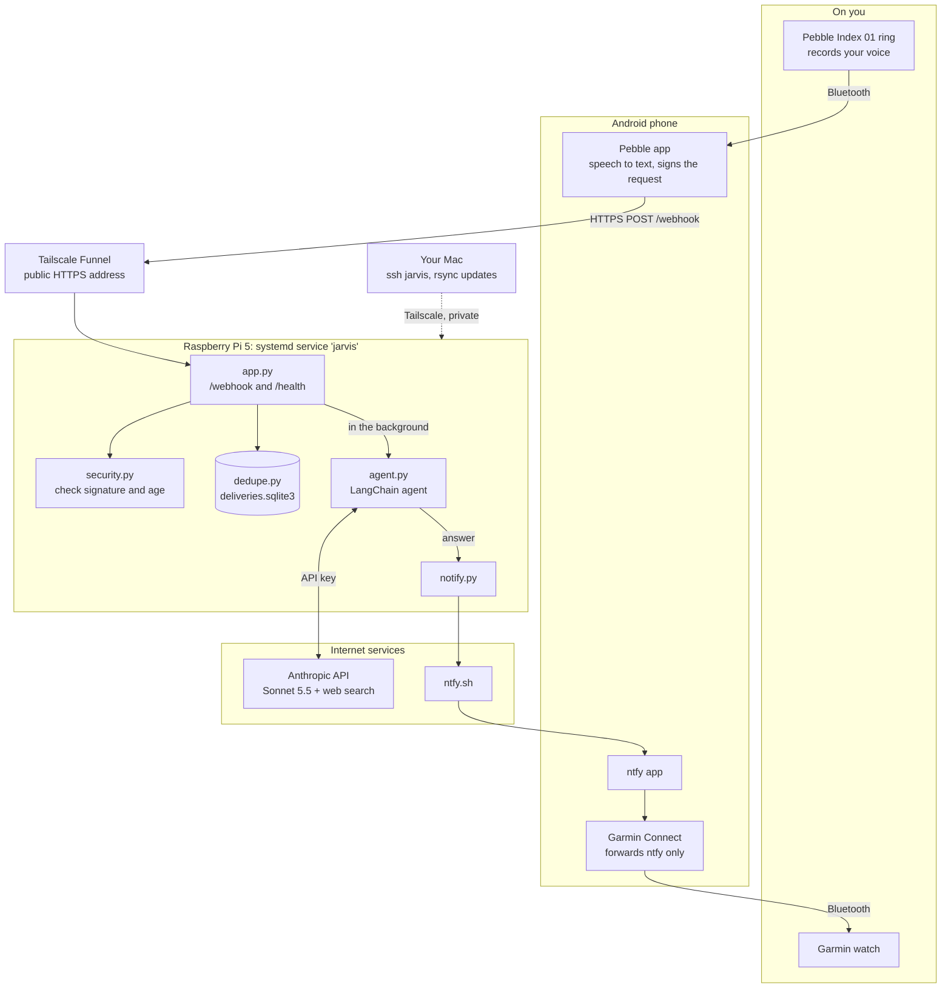

# Jarvis

A voice agent you talk to through a **Pebble Index 01** ring. Double-click and hold the ring, ask a question, and the answer arrives on your phone and Garmin watch a few seconds later.

It's built to grow: web search is the first ability, and new ones are Python functions added to a list.

## How it works

```
Ring ──Bluetooth──▶ Pebble app (phone) ──HTTPS──▶ jarvis.<tailnet>.ts.net
                    transcribes speech            │ Tailscale Funnel
                                                  ▼
                                    Raspberry Pi: Jarvis service
                                      1. security.verify   genuine request?
                                      2. dedupe            seen it before?
                                      3. reply "OK" at once
                                      4. agent.answer      Claude + web search  (background)
                                      5. notify.send       ──▶ ntfy ──▶ phone ──▶ Garmin
```

- **The ring** only records. Your phone's Pebble app turns the audio into text and posts it to Jarvis.
- **Tailscale Funnel** gives the Pi a public HTTPS address without opening anything on your router. Only Jarvis's port is public.
- **Jarvis replies "OK" straight away** and answers in the background, so the Pebble app never waits and retries.
- **Claude does the thinking and searching** on Anthropic's servers. The Pi mostly waits on the network, which is why a small computer is plenty.
- **ntfy** delivers the answer as a phone notification, which Garmin Connect forwards to the watch.

### Where everything runs



The solid arrows are one question's journey. The dotted arrow is how you maintain the Pi. Only `/webhook` and `/health` are reachable from the internet. The Mac's SSH access goes over Tailscale's private network and isn't public.

## The code

| File | Job |
|---|---|
| `jarvis/app.py` | The front door. Receives requests and coordinates the other modules |
| `jarvis/security.py` | Checks each request was signed by your Pebble app |
| `jarvis/dedupe.py` | Remembers handled recordings in `deliveries.sqlite3`, so repeats are ignored |
| `jarvis/agent.py` | **The only LangChain part.** `answer(question)` takes text in and returns text out |
| `jarvis/tools/__init__.py` | Jarvis's abilities: the `TOOLS` list |
| `jarvis/notify.py` | Sends text to your phone through ntfy |
| `tests/` | 31 automated tests. They fake Claude and ntfy, so they cost nothing |
| `scripts/send_test_request.py` | Acts as the Pebble app, for testing without the ring |
| `deploy/jarvis.service` | Keeps Jarvis running on the Pi |

### LangChain in one minute

- **Model** (`ChatAnthropic`): the connection to Claude.
- **Tool**: something Claude can ask to use. Claude only sees its name, arguments and docstring, so the docstring is effectively an instruction.
- **Agent** (`create_agent`): the loop. Ask Claude, run any tool it requests, give it the result, repeat until it answers without requesting a tool.
- **Messages**: the conversation so far. Each pass through the loop resends all of it, which is why each tool use adds cost.
- **Middleware**: plug-ins that wrap every model call. Jarvis uses `ModelRefusalMiddleware` to turn "Claude declined" into an error it can handle.

Tools run in one of two places. **Server tools**, like web search, run on Anthropic's servers within a single Claude call. **Your tools** are Python functions that run on the Pi, each one costing an extra call to Claude.

## Adding an ability

1. Write a function in `jarvis/tools/` and decorate it with `@tool`. Make the docstring say clearly when to use it.
2. Add it to `TOOLS` in `jarvis/tools/__init__.py`.
3. Test it on your Mac with `.venv/bin/python -m jarvis.agent "a question that needs it"`.
4. Update the Pi (see below).

```python
from langchain.tools import tool


@tool
def get_room_temperature(room: str) -> str:
    """Get the current temperature of a room in the user's home."""
    return read_sensor(room)  # your code here
```

**Safety rule:** Claude reads web pages, and a page could contain text written to trick it into using your tools. **Any tool that does something** (sends, buys, deletes, switches on) should ask you to confirm before acting.

## Day-to-day commands

Run these in Terminal on your Mac. They reach the Pi through **Tailscale**, so they work from anywhere, as long as the Tailscale app on your Mac is connected to the same account as the Pi. At home, `jarvis.local` may also work, but it's unreliable.

`jarvis` is a shortcut in `~/.ssh/config` on your Mac. `<tailnet>` stands for your Tailscale network's name, shown
in the Tailscale admin console under **DNS**. It's kept out of this README because the repo is public.

```
Host jarvis
    HostName jarvis.<tailnet>.ts.net
    User <your Pi username>
```

| What | Command |
|---|---|
| Is Jarvis running? | `ssh jarvis 'systemctl status jarvis'` |
| Watch the log live (Ctrl+C to stop) | `ssh jarvis 'journalctl -u jarvis -f'` |
| Token use per question | `ssh jarvis 'journalctl -u jarvis \| grep "tokens used"'` |
| Is it reachable from the internet? | Open `https://jarvis.<tailnet>.ts.net/health` and look for `{"status":"ok"}` |
| Run the tests on your Mac | `.venv/bin/pytest` |
| Ask a question without the ring | `.venv/bin/python scripts/send_test_request.py "your question" --url https://jarvis.<tailnet>.ts.net/webhook` |

### Checks on every push

GitHub runs these checks automatically on every push, to any branch. The setup is in
[.github/workflows/ci.yml](.github/workflows/ci.yml). Results show at the bottom of the PR and in the repo's
**Actions** tab. A red ✗ means don't merge yet. Click it to see which check failed and why.

| Check | What it does | Run it on your Mac first |
|---|---|---|
| Lint | Ruff checks for common mistakes and that the code is formatted. Settings are in `ruff.toml` | `.venv/bin/ruff check .` and `.venv/bin/ruff format --check .` (`.venv/bin/ruff format .` fixes formatting) |
| Commits | Every commit on the branch that isn't on `main` follows [templates/git/commit.txt](templates/git/commit.txt). Merge commits and `main` itself are skipped | `.venv/bin/python scripts/check_commits.py` |
| Secrets | gitleaks scans the whole git history for API keys, tokens and passwords. Allowed test values are in `.gitleaks.toml` | `gitleaks git --redact .` (install with `brew install gitleaks`) |
| Audit | pip-audit checks the libraries in `requirements.txt`, and the ones they bring in, for known security holes | `.venv/bin/pip-audit -r requirements.txt` |
| Types | mypy checks the code matches its type hints, such as passing text where bytes are expected. Settings are in `mypy.ini` | `.venv/bin/mypy` |
| Tests | Runs pytest on Python 3.14. No secrets needed, since Claude and ntfy are faked. Also measures coverage, which lines the tests run, and fails below 90%. The table is on the run's summary page. Settings are in `.coveragerc` | `.venv/bin/pytest --cov` |

**If the Secrets check fails, the secret is already on GitHub.** Removing it in a new commit isn't enough, because
it's still in the history. Replace it first (see [Security](#security) for each secret), then remove it from the code.
If it's a fake test value, add it to `.gitleaks.toml` instead.

**If the Audit check fails,** its log names the library, the problem and the first version that fixes it. Raise that
version in `requirements.txt`, check the tests pass, and update the Pi.

**Dependabot** ([.github/dependabot.yml](.github/dependabot.yml)) opens a PR every Monday when there are newer
versions of the libraries or the GitHub Actions, one PR for each. CI tests it like any other PR. Merging it still
needs the usual Pi update. Its PRs skip the Commits check and send no ntfy message.

To check exactly what's installed on the Pi, including libraries that aren't pinned:

```bash
ssh jarvis '~/jarvis/.venv/bin/pip freeze' > /tmp/pi-freeze.txt
.venv/bin/pip-audit -r /tmp/pi-freeze.txt --no-deps --disable-pip
```

When the checks finish, a **Notify** step sends ✅ or ❌ to your phone and Garmin through ntfy, with the branch,
the commit, and any failed checks. Tap the message to open the run. CI uses its own topic, separate from Jarvis's
answers, stored as the GitHub Actions secret `NTFY_TOPIC` (Settings → Secrets and variables → Actions). To move to a
new topic, subscribe to it in the ntfy app and run `gh secret set NTFY_TOPIC`.

Each run takes about a minute. Actions minutes are free and unlimited for public repos.

### Updating the Pi after changing code

From the `Jarvis2.0` folder on your Mac:

```bash
# 1. Copy changes across (only what changed is sent)
rsync -a --exclude '.venv/' --exclude '__pycache__/' --exclude '.pytest_cache/' \
      --exclude '.ruff_cache/' --exclude '.mypy_cache/' --exclude '.coverage' \
      --exclude '*.sqlite3' --exclude '.DS_Store' --exclude '.git/' \
      ./ jarvis:~/jarvis/

# 2. Only if requirements.txt changed: install the new libraries
ssh jarvis 'cd ~/jarvis && .venv/bin/pip install -r requirements.txt'

# 3. Restart Jarvis (asks for your Pi password)
ssh -t jarvis 'sudo systemctl restart jarvis'
```

### Python on the Pi

Jarvis runs on **Python 3.14**, the same as the Mac. Debian on the Pi only ships 3.13, so 3.14 is installed with
[uv](https://docs.astral.sh/uv/) in your user folder (`~/.local/share/uv/python/`), separate from the system Python.
`apt upgrade` doesn't update it, so now and then run:

```bash
ssh jarvis '~/.local/bin/uv python upgrade 3.14'
```

The venv uses whatever 3.14 patch release uv has, so a restart picks up the upgrade.

To rebuild the venv, for example when moving to a new Python version (Jarvis is down for about 30 seconds):

```bash
ssh -t jarvis 'set -e; cd ~/jarvis; sudo -v
sudo systemctl stop jarvis
mv .venv .venv-old
~/.local/bin/uv venv --python 3.14 --seed .venv
.venv/bin/pip install -q -r requirements.txt
sudo systemctl start jarvis'
```

If it fails, put the old one back with `rm -rf .venv && mv .venv-old .venv` and restart. Don't rename a venv to
`.venv`, because the programs inside it still point at the old folder name.

## Settings

`.env` holds these. It's never copied into git, and on the Pi only your user can read it.

| Setting | Purpose |
|---|---|
| `ANTHROPIC_API_KEY` | Pays for Claude. Manage it at [console.anthropic.com](https://console.anthropic.com) |
| `JARVIS_MODEL` | Which Claude model to use. Currently `claude-sonnet-5-5` |
| `NTFY_TOPIC` | Your private ntfy topic. Anyone who knows it can read your answers |
| `WEBHOOK_SECRET` | Shared with the Pebble app, which signs each request with it |

`.env.example` lists the same settings with blank values.

### Pebble app webhook (Double click & hold)

| Setting | Value |
|---|---|
| URL | `https://jarvis.<tailnet>.ts.net/webhook` |
| Payload | **Transcription only** |
| Signing | On, with the `WEBHOOK_SECRET` value |
| Ring Button | Don't send this gesture to the **Index agent**, otherwise Pebble's built-in assistant answers as well as Jarvis. The webhook still fires |

Recordings made while the phone is out of range are stored on the ring and sent when it reconnects. Pebble signs them when sending, so they pass the 5-minute check.

## Costs

Measured on real questions with Sonnet 5.5:

| Question | Input tokens | Approximate cost |
|---|---|---|
| Needs a web search | about 20,000 | 5 cents |
| Answered without searching | about 6,000 | 1 cent |

Even a question with no search sends about 6,000 tokens, because describing the search tool to Claude takes that much. Check real spending on the Console's **Usage** and **Cost** pages, and keep a monthly spend limit set there.

## Security

- **Signatures:** anything not signed with your secret gets `401 unauthorized`. Requests older than 5 minutes are rejected too, so a recorded request can't be replayed.
- **Only two addresses exist,** `/health` and `/webhook`. Automated scanners find every new public address within minutes and try paths like `/.env`. They all get `404`, and you'll see them in the log. That's normal.
- **The service runs as your user,** can't gain admin rights, and can only write inside `~/jarvis`.
- **If a secret leaks:** for the webhook secret, generate a new one, put it in `.env` on the Pi and in the Pebble app, and restart Jarvis. For the API key, delete it in the Console and create a new one. For the ntfy topic, pick a new random name, update `.env`, and resubscribe on your phone.

## Troubleshooting

| Symptom | Likely cause |
|---|---|
| Log says `empty transcription ignored` | The webhook payload isn't set to **Transcription only** |
| Log says `rejected request: signature does not match` | The secret in the Pebble app differs from `WEBHOOK_SECRET` |
| Log says `timestamp outside the 5-minute window` | The phone's or Pi's clock is wrong |
| You get two answers | Pebble's built-in assistant is also handling the gesture. In the Pebble app's **Ring Button** settings, stop sending Double click & hold to the Index agent |
| "Couldn't answer: …" | Claude or the network failed. The log has the details (`journalctl -u jarvis`) |
| Nothing arrives at all | Check `/health` in a browser, then the log, then that the ntfy app is subscribed to the right topic |
| Answer on phone but not watch | Garmin Connect needs **Notification access**, and ntfy must be on in its app list |
| Can't reach the Pi from the Mac | Check the Tailscale app on the Mac is connected, then try `ssh jarvis` again |
| Nothing on the Garmin | It may be in sleep mode or Do Not Disturb. Answers still arrive on the phone |
