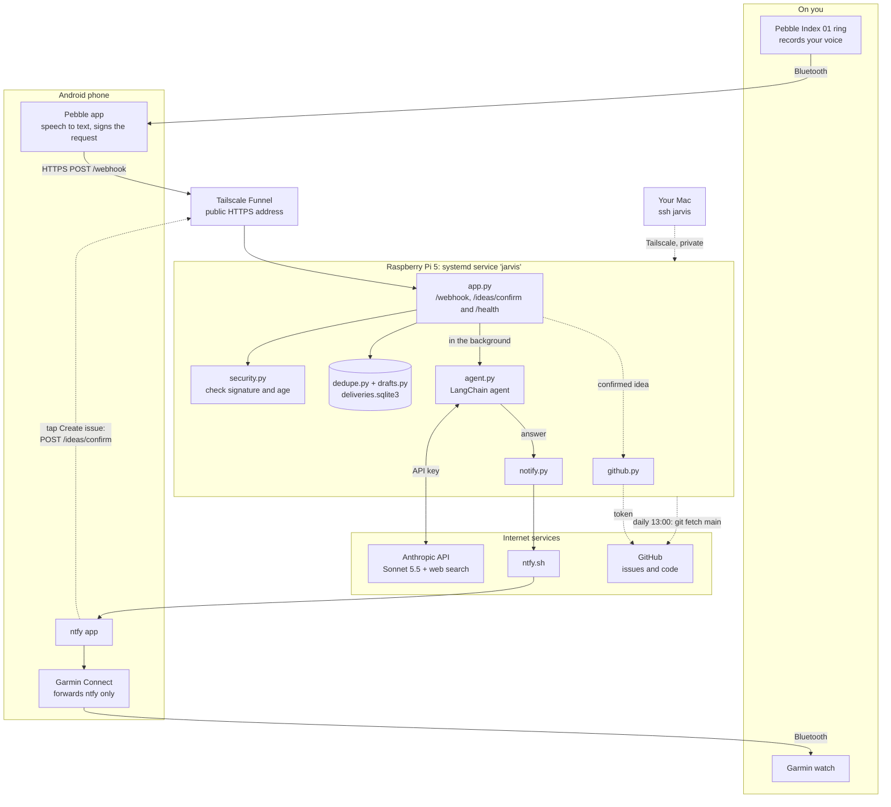

# Jarvis

A voice agent you talk to through a **Pebble Index 01** ring. Double-click and hold the ring, ask a question, and the answer arrives on your phone and Garmin watch a few seconds later.

It's built to grow: its abilities are web search and [turning ideas into GitHub issues](#ideas-by-voice), and new ones are Python functions added to a list.

## How it works

```
Ring ──Bluetooth──▶ Pebble app (phone) ──HTTPS──▶ jarvis.<tailnet>.ts.net
                    transcribes speech            │ Tailscale Funnel
                                                  ▼
                                    Raspberry Pi: Jarvis service
                                      1. security.verify   genuine request?
                                      2. dedupe            seen it before?
                                      3. reply "OK" at once
                                      4. agent.answer      Claude + web search  (background)
                                      5. notify.send       ──▶ ntfy ──▶ phone ──▶ Garmin
```

- **The ring** only records. Your phone's Pebble app turns the audio into text and posts it to Jarvis.
- **Tailscale Funnel** gives the Pi a public HTTPS address without opening anything on your router. Only Jarvis's port is public.
- **Jarvis replies "OK" straight away** and answers in the background, so the Pebble app never waits and retries.
- **Claude does the thinking and searching** on Anthropic's servers. The Pi mostly waits on the network, which is why a small computer is plenty.
- **ntfy** delivers the answer as a phone notification, which Garmin Connect forwards to the watch.

### Where everything runs



The solid arrows are one question's journey. The dotted arrows are an idea's last step, when you tap **Create issue**, and how the Pi is maintained: you over SSH, and the daily deploy, which fetches new code from GitHub. Only `/webhook`, `/ideas/confirm` and `/health` are reachable from the internet. The Mac's SSH access goes over Tailscale's private network and isn't public.

## The code

| File | Job |
|---|---|
| `jarvis/app.py` | The front door. Receives requests and coordinates the other modules |
| `jarvis/security.py` | Checks each request was signed by your Pebble app |
| `jarvis/dedupe.py` | Remembers handled recordings in `deliveries.sqlite3`, so repeats are ignored |
| `jarvis/agent.py` | **The only LangChain part.** `answer(question)` takes text in and returns text out |
| `jarvis/tools/__init__.py` | Jarvis's abilities: the `TOOLS` list |
| `jarvis/tools/ideas.py` | The `propose_issue` ability: drafts an issue and sends it to your phone to confirm |
| `jarvis/drafts.py` | Keeps idea drafts until you confirm them, under one-time codes |
| `jarvis/github.py` | Creates a GitHub issue once you've confirmed an idea |
| `jarvis/notify.py` | Sends text to your phone through ntfy, with optional buttons and links |
| `tests/` | 120 automated tests. They fake Claude, ntfy, GitHub and the Pi's commands, so they cost nothing |
| `scripts/send_test_request.py` | Acts as the Pebble app, for testing without the ring |
| `scripts/deploy.py` | The daily deploy on the Pi: fetches `main`, checks CI passed, tests, restarts, goes back if anything fails |
| `deploy/jarvis.service` | Keeps Jarvis running on the Pi |
| `deploy/jarvis-deploy.timer` + `.service` | Run `scripts/deploy.py` every day at 13:00 |
| `deploy/sudoers-jarvis-deploy` | Lets the deploy run `systemctl restart jarvis`, and nothing else, without your password |

### LangChain in one minute

- **Model** (`ChatAnthropic`): the connection to Claude.
- **Tool**: something Claude can ask to use. Claude only sees its name, arguments and docstring, so the docstring is effectively an instruction.
- **Agent** (`create_agent`): the loop. Ask Claude, run any tool it requests, give it the result, repeat until it answers without requesting a tool.
- **Messages**: the conversation so far. Each pass through the loop resends all of it, which is why each tool use adds cost.
- **Middleware**: plug-ins that wrap every model call. Jarvis uses `ModelRefusalMiddleware` to turn "Claude declined" into an error it can handle.

Tools run in one of two places. **Server tools**, like web search, run on Anthropic's servers within a single Claude call. **Your tools** are Python functions that run on the Pi, each one costing an extra call to Claude.

## Adding an ability

1. Write a function in `jarvis/tools/` and decorate it with `@tool`. Make the docstring say clearly when to use it.
2. Add it to `TOOLS` in `jarvis/tools/__init__.py`.
3. Test it on your Mac with `.venv/bin/python -m jarvis.agent "a question that needs it"`.
4. Open a PR and merge it. The Pi picks it up at 13:00 (see [Deploying to the Pi](#deploying-to-the-pi)).

```python
from langchain.tools import tool


@tool
def get_room_temperature(room: str) -> str:
    """Get the current temperature of a room in the user's home."""
    return read_sensor(room)  # your code here
```

**Safety rule:** Claude reads web pages, and a page could contain text written to trick it into using your tools. **Any tool that does something** (sends, buys, deletes, switches on) should ask you to confirm before acting. `propose_issue` shows one way: the tool only drafts, and a button on your phone does the rest.

## Ideas by voice

Say an idea for Jarvis to the ring, such as *"New idea: Jarvis should tell me when my train is late"*, and it becomes an issue in this repo.

1. Claude turns what you said into a short title and description, fixing misheard words, and calls `propose_issue`.
2. Your phone gets a **New idea - tap to publish** notification with the exact text and a **Create issue** button. Jarvis's reply says the draft is waiting.
3. Tap **Create issue**. A moment later, **Created #31: …** arrives. Tap it to open the issue.

**Nothing is published until you tap.** The repo is public, so read the draft first. Not tapping is a "no", and the draft expires after 24 hours. Each button works once.

The button carries a random one-time code, and `/ideas/confirm` creates the issue only for a code it handed out. A web page that tricks Claude into calling `propose_issue` can only send you a draft to ignore.

### Creating the GitHub token

1. On GitHub, open **Settings → Developer settings → Personal access tokens → Fine-grained tokens → Generate new token**.
2. **Expiration:** up to a year. Put a reminder in your calendar to replace it.
3. **Repository access:** **Only select repositories**, then pick `Jarvis2.0`.
4. **Permissions → Repository permissions → Issues:** **Read and write**. Leave everything else at **No access**. GitHub adds **Metadata: Read** by itself.
5. Copy the token into `GITHUB_TOKEN` in `.env` on the Pi, set `GITHUB_REPO` and `JARVIS_PUBLIC_URL` (see [Settings](#settings)), and restart Jarvis.

The token can only open, edit and close issues in this one repo. It can't touch the code.

## Day-to-day commands

Run these in Terminal on your Mac. They reach the Pi through **Tailscale**, so they work from anywhere, as long as the Tailscale app on your Mac is connected to the same account as the Pi. At home, `jarvis.local` may also work, but it's unreliable.

`jarvis` is a shortcut in `~/.ssh/config` on your Mac. `<tailnet>` stands for your Tailscale network's name, shown
in the Tailscale admin console under **DNS**. It's kept out of this README because the repo is public.

```
Host jarvis
    HostName jarvis.<tailnet>.ts.net
    User <your Pi username>
```

| What | Command |
|---|---|
| Is Jarvis running? | `ssh jarvis 'systemctl status jarvis'` |
| Watch the log live (Ctrl+C to stop) | `ssh jarvis 'journalctl -u jarvis -f'` |
| Token use per question | `ssh jarvis 'journalctl -u jarvis \| grep "tokens used"'` |
| Is it reachable from the internet? | Open `https://jarvis.<tailnet>.ts.net/health` and look for `{"status":"ok"}` |
| Run the tests on your Mac | `.venv/bin/pytest` |
| Ask a question without the ring | `.venv/bin/python scripts/send_test_request.py "your question" --url https://jarvis.<tailnet>.ts.net/webhook` |

### Checks on every push, and weekly

GitHub runs these checks automatically on every push, to any branch. The setup is in
[.github/workflows/ci.yml](.github/workflows/ci.yml). Results show at the bottom of the PR and in the repo's
**Actions** tab. A red ✗ means don't merge yet. Click it to see which check failed and why.

They also run on `main` every Monday at 07:00 UTC, even with no push, because new security holes and new gitleaks
rules appear without any change here. To run that check now, use **Run workflow** on the CI page of the Actions tab,
or `gh workflow run CI --ref main`.

| Check | What it does | Run it on your Mac first |
|---|---|---|
| Lint | Ruff checks for common mistakes and that the code is formatted. Settings are in `ruff.toml`. actionlint checks `ci.yml` itself for mistakes, including its shell scripts. `systemd-analyze verify` checks the service and timer files in `deploy/` for typos | `.venv/bin/ruff check .` and `.venv/bin/ruff format --check .` (`.venv/bin/ruff format .` fixes formatting). `actionlint` (install with `brew install actionlint shellcheck`). The service files can only be checked on Linux |
| Commits | Every commit on the branch that isn't on `main` follows [templates/git/commit.txt](templates/git/commit.txt). Merge commits and `main` itself are skipped | `.venv/bin/python scripts/check_commits.py` |
| Secrets | gitleaks scans the whole git history for API keys, tokens and passwords. Allowed test values are in `.gitleaks.toml` | `gitleaks git --redact .` (install with `brew install gitleaks`) |
| Audit | pip-audit checks the libraries in `requirements.txt`, and the ones they bring in, for known security holes | `.venv/bin/pip-audit -r requirements.txt` |
| Types | mypy checks the code matches its type hints, such as passing text where bytes are expected. Settings are in `mypy.ini` | `.venv/bin/mypy` |
| Tests | Runs pytest on Python 3.14. No secrets needed, since Claude and ntfy are faked. Also measures coverage, which lines the tests run, and fails below 90%. The table is on the run's summary page. Settings are in `.coveragerc` | `.venv/bin/pytest --cov` |

**If the Secrets check fails, the secret is already on GitHub.** Removing it in a new commit isn't enough, because
it's still in the history. Replace it first (see [Security](#security) for each secret), then remove it from the code.
If it's a fake test value, add it to `.gitleaks.toml` instead.

**If the Audit check fails,** its log names the library, the problem and the first version that fixes it. Raise that
version in `requirements.txt`, check the tests pass, and merge. The daily deploy installs it on the Pi.

**Dependabot** ([.github/dependabot.yml](.github/dependabot.yml)) opens a PR every Monday when there are newer
versions of the libraries or the GitHub Actions, one PR for each. CI tests it like any other PR. Nothing reaches the
Pi until you merge it; then the daily deploy picks it up like any other merge. Its PRs skip the Commits check and send
no ntfy message.

**Actions are pinned to a commit SHA** (`actions/checkout@3d3c42e… # v7.0.1`), not a tag like `@v7`. Whoever controls
an action can move a tag to different code, but not a SHA. Dependabot updates both the SHA and the comment, and a repo
setting (Settings → Actions → General) refuses to run any action that isn't pinned this way.

**GitHub's security settings** (Settings → Advanced Security), all free for public repos:

| Setting | What it does |
|---|---|
| Dependabot alerts | Warns you, under the **Security** tab, when a library in `requirements.txt` has a known security hole |
| Dependabot security updates | Opens a PR straight away to fix such a hole, without waiting for Monday |
| Secret scanning | Looks for known kinds of secrets, such as API keys, anywhere in the repo and alerts you |
| Push protection | **Refuses a push** that contains a known kind of secret, before it reaches GitHub. Remove the secret from the commit (`git commit --amend`, or rewrite the branch) and push again. Unlike the Secrets check, nothing has leaked yet |

To check exactly what's installed on the Pi, including libraries that aren't pinned:

```bash
ssh jarvis '~/jarvis/.venv/bin/pip freeze' > /tmp/pi-freeze.txt
.venv/bin/pip-audit -r /tmp/pi-freeze.txt --no-deps --disable-pip
```

When the checks finish, a **Notify** step sends ✅ or ❌ to your phone and Garmin through ntfy, with the branch,
the commit, and any failed checks. The Monday run's message says **Weekly check** instead. Tap the message to open the run. CI uses its own topic, separate from Jarvis's
answers, stored as the GitHub Actions secret `NTFY_TOPIC` (Settings → Secrets and variables → Actions). To move to a
new topic, subscribe to it in the ntfy app and run `gh secret set NTFY_TOPIC`.

Each run takes about a minute. Actions minutes are free and unlimited for public repos.

### Deploying to the Pi

**Merging to `main` is enough.** Every day at 13:00 (Pi time), the Pi runs [scripts/deploy.py](scripts/deploy.py).
If `main` has a new commit, it:

1. Asks GitHub whether CI passed on it, waiting up to 15 minutes if CI is still running. If CI failed, it never
   deploys that commit.
2. Moves `~/jarvis` to the new commit with git, and installs libraries if `requirements.txt` changed.
3. Runs the tests on the Pi, restarts Jarvis, and checks `/health`.
4. Sends **✅ Deployed to the Pi** to your phone, or **❌ Deploy failed** with the reason. On a failure it has already
   gone back to the previous commit, so Jarvis keeps running the old code. That commit is never retried; merge a fix
   and the next run deploys it.

Only Jarvis restarts, for a few seconds, not the Pi. The deploy is a separate service (`jarvis-deploy`), so it keeps
running while Jarvis restarts. GitHub never connects to the Pi: the Pi fetches from the public repo, so GitHub holds
no SSH key or Tailscale access.

| What | Command |
|---|---|
| Deploy now, without waiting for 13:00 | `ssh -t jarvis 'sudo systemctl start jarvis-deploy'` |
| What the last deploys did | `ssh jarvis 'journalctl -u jarvis-deploy -n 50'` |
| When it runs next | `ssh jarvis 'systemctl list-timers jarvis-deploy'` |
| Which commit is running | `ssh jarvis 'git -C ~/jarvis log -1 --oneline'` |

**`.env`, `.venv/` and `deliveries.sqlite3` are never touched.** They aren't in git, and the deploy never deletes
files git doesn't know about. The Pi's `.env` has settings the Mac's doesn't, such as `GITHUB_TOKEN`. To change a
setting, edit it on the Pi with `ssh -t jarvis 'nano ~/jarvis/.env'`, then restart Jarvis.

**Trying unmerged code on the Pi** is still possible with rsync, but the next deploy replaces it with `main`:

```bash
rsync -a --exclude '.env' --exclude '.vscode/' \
      --exclude '.venv/' --exclude '.venv-*/' --exclude '__pycache__/' --exclude '.pytest_cache/' \
      --exclude '.ruff_cache/' --exclude '.mypy_cache/' --exclude '.coverage' \
      --exclude '*.sqlite3' --exclude '.DS_Store' --exclude '.git/' --exclude '.deploy-*' \
      ./ jarvis:~/jarvis/
ssh -t jarvis 'sudo systemctl restart jarvis'
```

#### One-time setup on the Pi

Done once, after the PR that added the deploy was merged. Each `sudo` asks for your Pi password.

```bash
ssh -t jarvis
cd ~/jarvis

# 1. Make the folder a git checkout of main. "git reset" without --hard adopts the
#    history and keeps every file as it is. git status should then show no changes.
git init -b main
git remote add origin https://github.com/jcbanos/Jarvis2.0.git
git fetch origin main
git reset origin/main
git status

# 2. Allow the deploy to restart Jarvis without a password. visudo checks the file
#    first, because a broken sudo rule can lock you out of sudo.
sudo visudo -c -f deploy/sudoers-jarvis-deploy
sudo install -m 440 deploy/sudoers-jarvis-deploy /etc/sudoers.d/jarvis-deploy
sudo -n /usr/bin/systemctl restart jarvis && echo "restart works without a password"

# 3. Install and start the daily timer, then run one deploy now to check it.
sudo cp deploy/jarvis-deploy.service deploy/jarvis-deploy.timer /etc/systemd/system/
sudo systemctl daemon-reload
sudo systemctl enable --now jarvis-deploy.timer
sudo systemctl start jarvis-deploy
journalctl -u jarvis-deploy -n 20    # should end with "Up to date"
```

If `git status` in step 1 lists changed files, the Pi was running code that differs from `main`. Check them with
`git diff` before going on: the first deploy will replace them.

If you change `jarvis-deploy.service` or `.timer` later, the deploy updates the files in `~/jarvis`, but systemd
keeps using its copies. Repeat step 3's `cp` and `daemon-reload`.

### Python on the Pi

Jarvis runs on **Python 3.14**, the same as the Mac. Debian on the Pi only ships 3.13, so 3.14 is installed with
[uv](https://docs.astral.sh/uv/) in your user folder (`~/.local/share/uv/python/`), separate from the system Python.
`apt upgrade` doesn't update it, so now and then run:

```bash
ssh jarvis '~/.local/bin/uv python upgrade 3.14'
```

The venv uses whatever 3.14 patch release uv has, so a restart picks up the upgrade. The daily deploy runs with the
same Python through `~/.local/bin/python3.14`, but outside the venv, so it can still go back if the venv breaks.
Moving to a new version such as 3.15 means also changing that path in `deploy/jarvis-deploy.service`.

To rebuild the venv, for example when moving to a new Python version (Jarvis is down for about 30 seconds):

```bash
ssh -t jarvis 'set -e; cd ~/jarvis; sudo -v
sudo systemctl stop jarvis
mv .venv .venv-old
~/.local/bin/uv venv --python 3.14 --seed .venv
.venv/bin/pip install -q -r requirements.txt
sudo systemctl start jarvis'
```

If it fails, put the old one back with `rm -rf .venv && mv .venv-old .venv` and restart. Don't rename a venv to
`.venv`, because the programs inside it still point at the old folder name.

## Settings

`.env` holds these. It's never copied into git, and on the Pi only your user can read it.

| Setting | Purpose |
|---|---|
| `ANTHROPIC_API_KEY` | Pays for Claude. Manage it at [console.anthropic.com](https://console.anthropic.com) |
| `JARVIS_MODEL` | Which Claude model to use. Currently `claude-sonnet-5-5` |
| `NTFY_TOPIC` | Your private ntfy topic. Anyone who knows it can read your answers |
| `WEBHOOK_SECRET` | Shared with the Pebble app, which signs each request with it |
| `GITHUB_TOKEN` | Creates issues from your ideas. A fine-grained token for this repo, with Issues access only ([how to create it](#creating-the-github-token)) |
| `GITHUB_REPO` | The repo ideas go to, as `owner/name`. Currently `jcbanos/Jarvis2.0` |
| `JARVIS_PUBLIC_URL` | The Pi's public address, `https://jarvis.<tailnet>.ts.net`, without `/webhook`. The **Create issue** button calls it |

`.env.example` lists the same settings with blank values.

### Pebble app webhook (Double click & hold)

| Setting | Value |
|---|---|
| URL | `https://jarvis.<tailnet>.ts.net/webhook` |
| Payload | **Transcription only** |
| Signing | On, with the `WEBHOOK_SECRET` value |
| Ring Button | Don't send this gesture to the **Index agent**, otherwise Pebble's built-in assistant answers as well as Jarvis. The webhook still fires |

Recordings made while the phone is out of range are stored on the ring and sent when it reconnects. Pebble signs them when sending, so they pass the 5-minute check.

## Costs

Measured on real questions with Sonnet 5.5:

| Question | Input tokens | Approximate cost |
|---|---|---|
| Needs a web search | about 20,000 | 5 cents |
| Answered without searching | about 6,000 | 1 cent |
| An idea (drafting the issue) | about 13,000 | 2 cents |

Even a question with no search sends about 6,000 tokens, because describing the search tool to Claude takes that much. The rows above were measured before `propose_issue` existed, and describing it adds about 2,000 tokens to every question: a weather question measured 22,000 with it. An idea takes two calls to Claude, one to draft it and one to write the reply after the tool runs. Check real spending on the Console's **Usage** and **Cost** pages, and keep a monthly spend limit set there.

## Security

- **Signatures:** anything not signed with your secret gets `401 unauthorized`. Requests older than 5 minutes are rejected too, so a recorded request can't be replayed.
- **Only three addresses exist,** `/health`, `/webhook` and `/ideas/confirm`. Automated scanners find every new public address within minutes and try paths like `/.env`. They all get `404`, and you'll see them in the log. That's normal.
- **`/ideas/confirm`** needs no signature. Its proof is the one-time code from the button: 32 random bytes, valid for 24 hours, used once. Only its fingerprint (SHA-256) is stored, so even a copy of `deliveries.sqlite3` can't confirm a draft. A wrong code gets `404` and `unknown idea code` in the log.
- **The log** (`journalctl -u jarvis`) holds the first 40 characters of each question, token use, rejected requests
  and errors. It never holds the ntfy topic, the webhook secret, the API key, the GitHub token or an idea's code, and tests check this.
- **The service runs as your user,** can't gain admin rights, and can only write inside `~/jarvis`.
- **If a secret leaks:** for the webhook secret, generate a new one, put it in `.env` on the Pi and in the Pebble app, and restart Jarvis. For the API key, delete it in the Console and create a new one. For the ntfy topic, pick a new random name, update `.env`, and resubscribe on your phone. Anyone who read the topic could also have seen unconfirmed idea drafts and their codes, so the new topic also protects drafts. For the GitHub token, delete it on GitHub's Fine-grained tokens page, create a new one, update `.env`, and restart Jarvis.

## Troubleshooting

| Symptom | Likely cause |
|---|---|
| Log says `empty transcription ignored` | The webhook payload isn't set to **Transcription only** |
| Log says `rejected request: signature does not match` | The secret in the Pebble app differs from `WEBHOOK_SECRET` |
| Log says `timestamp outside the 5-minute window` | The phone's or Pi's clock is wrong |
| You get two answers | Pebble's built-in assistant is also handling the gesture. In the Pebble app's **Ring Button** settings, stop sending Double click & hold to the Index agent |
| "Couldn't answer: …" | Claude or the network failed. The log has the details (`journalctl -u jarvis`) |
| Nothing arrives at all | Check `/health` in a browser, then the log, then that the ntfy app is subscribed to the right topic |
| Answer on phone but not watch | Garmin Connect needs **Notification access**, and ntfy must be on in its app list |
| Can't reach the Pi from the Mac | Check the Tailscale app on the Mac is connected, then try `ssh jarvis` again |
| Nothing on the Garmin | It may be in sleep mode or Do Not Disturb. Answers still arrive on the phone |
| Tapping **Create issue** does nothing | `JARVIS_PUBLIC_URL` is wrong or missing in `.env`, or the Pi isn't reachable. Check `/health` in a browser |
| Log says `unknown idea code` | The button was tapped twice, the draft is over 24 hours old, or something tried a made-up code |
| "Couldn't create the issue: …" | The log says why. `GitHub replied 401`: the token expired or was mistyped. `403`: it lacks Issues access. `404`: `GITHUB_REPO` is wrong, or the token isn't for that repo |
| An idea was answered like a question, with no draft | Claude didn't recognise it as an idea. Start with "New idea:" |
